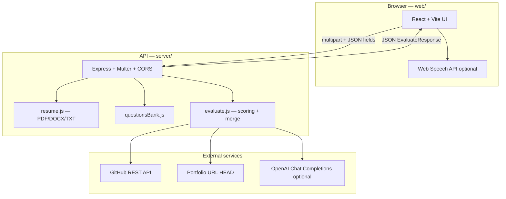
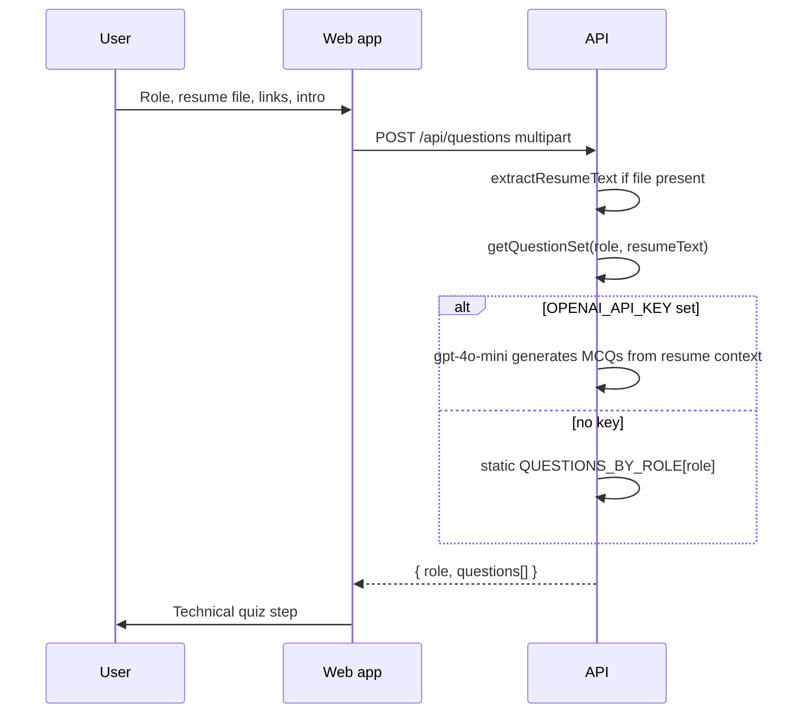
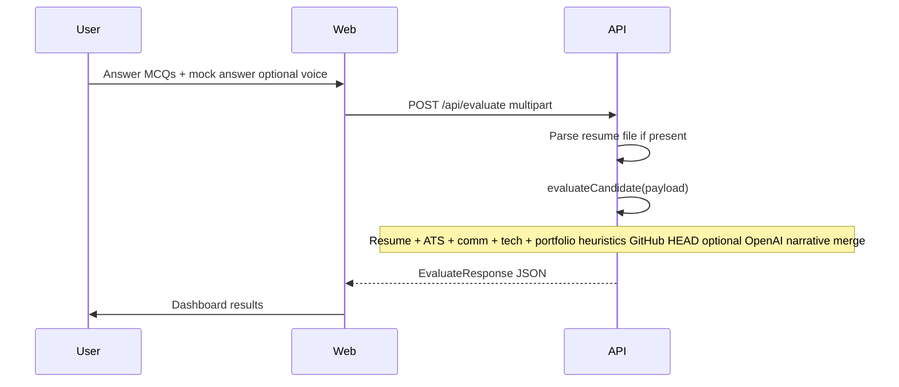

# AI Interview Readiness Platform

A full-stack **career intelligence** application that simulates recruiter-style screening: resume parsing, ATS-style keyword fit, role-specific technical quizzes, communication and mock-interview analysis, GitHub/portfolio signals, weighted readiness scoring, shortlist simulation, explainable metrics, and a structured improvement roadmap—with optional **OpenAI** enrichment for narrative copy while **numeric scores stay deterministic**.

---

## Table of contents

1. [What this platform does](#what-this-platform-does)  
2. [High-level architecture](#high-level-architecture)  
3. [User journey & pipelines](#user-journey--pipelines)  
4. [Evaluation engine (server)](#evaluation-engine-server)  
5. [API reference](#api-reference)  
6. [Frontend application](#frontend-application)  
7. [Environment variables](#environment-variables)  
8. [Local development](#local-development)  
9. [Production deployment](#production-deployment)  
10. [Security & limits](#security--limits)  
11. [Tech stack](#tech-stack)  
12. [Repository layout](#repository-layout)  
13. [Roadmap & known limitations](#roadmap--known-limitations)

---

## What this platform does

| Capability | Description |
|------------|-------------|
| **Resume intelligence** | PDF / DOCX / TXT extraction; section detection; quantified-impact and action-verb heuristics; readability signals; role keyword coverage. |
| **ATS-style fit** | Primary/secondary keyword ratios vs role lexicon; missing-keyword list; section-aware ATS score. |
| **Technical screen** | Five MCQs per role from a curated bank; optional resume-aware AI-generated questions when `OPENAI_API_KEY` is set. |
| **Communication** | Combined analysis of **introduction** + **mock interview answer**: length, filler words, STAR-style cues, ownership language. |
| **Portfolio / GitHub** | Link validation, GitHub public API (repos, stars, languages), optional portfolio URL reachability (HTTP `HEAD`). |
| **Weighted readiness** | Overall score from role-adjusted weights (not a single fixed template for every role). |
| **Screening composite** | Shortlist (Yes / Maybe / No) uses overall score plus penalties for very weak communication or missing/poor quiz performance. |
| **Recruiter simulation** | Verdict band, likelihood, concerns, “why you might fail,” pressure-handling heuristic—all derived from dimensional scores unless AI adds prose. |
| **Roadmap** | Three phases with role-specific titles, concrete tasks, and curated resource links; items shaped for the dashboard (`{ text, link? }`). |
| **Dashboard** | Radar chart, heatmaps, timelines, hiring probability bands, career suggestions, replay-style highlights from mock text. |
| **Speech (optional)** | Client-side **Web Speech API** for dictation into forms—not server-side audio analysis. |

---

## High-level architecture

The system is a **stateless** monorepo: the browser talks to a **Node/Express** API; there is no database in the default stack. Each evaluation is computed from the request payload plus optional external calls (GitHub, portfolio `HEAD`, OpenAI).



**Design principle:** deterministic engines own **numbers and structure**; OpenAI (when enabled) enriches **narrative** fields and must not contradict the returned core scores (the server re-applies canonical scores on the response).

---

## User journey & pipelines

### A. Intake → personalized questions



### B. Quiz → mock interview → evaluation



### C. Server-side evaluation pipeline (`evaluate.js`)

Conceptual stages (single async function orchestrates all of this):

1. **Resume heuristic** — word count bands, section regex map, quantified metrics, action verbs, role keyword hits, readability repetition / long sentences, contact links.  
2. **Technical score** — `scoreTechnical(role, techAnswers)` over questions whose `id` keys exist in the submitted map (0% if nothing submitted).  
3. **Communication heuristic** — merged **intro + mock** text; filler ratio; STAR / ownership / structure cues; fatigue-style flag from patterns.  
4. **Portfolio heuristic** — GitHub username parse → `api.github.com` user + repos; LinkedIn/portfolio flags; resume cross-check; portfolio `HEAD` when URL present.  
5. **Role weights** — `getRoleWeights(role)` adjusts resume/technical/communication/portfolio weights (e.g. heavier technical for AI/backend, heavier portfolio for design).  
6. **Overall score** — weighted sum of the four dimension scores (plus optional senior/junior nudge on technical).  
7. **Screening composite** — adjusts how harsh shortlist thresholds are when communication or quiz evidence is weak.  
8. **Deterministic derivatives** — explainable contributors, timeline, replay segments from mock text, benchmarking estimate, hiring bands, persona fallback, behavioral heuristics, roadmap normalization, etc.  
9. **OpenAI (optional)** — narrative: insight, recruiter reasoning, evidence panels, resume rewrites, next steps; system prompt instructs the model **not** to emit server-owned numeric blocks.  
10. **Response assembly** — merge AI strings with deterministic numbers; force radar/resume/technical/communication/portfolio scores to canonical values.

---

## Evaluation engine (server)

### Role-aware weights (examples)

| Role profile | Emphasis (conceptually) |
|--------------|-------------------------|
| Default / Full stack | Balanced resume / technical / comm / portfolio |
| AI / ML engineer | Higher **technical**, adjusted resume/portfolio |
| UI/UX designer | Higher **portfolio**, meaningful comm |
| Data analyst | Slightly higher **resume** + technical balance |
| Backend engineer | Higher **technical** |

Exact fractions are defined in `getRoleWeights()` in `server/src/evaluate.js`.

### Shortlist logic

- **Overall** = weighted dimensional scores.  
- **Screening composite** = overall with deductions for very low communication and for missing or weak quiz ratios.  
- **Shortlist** = `yes` / `maybe` / `no` from composite against fixed thresholds (see `shortlist()` in `evaluate.js`).  
- **Verdict band** = human-readable label (e.g. “High technical potential / packaging gap”) from shortlist + dimension pattern.

### What is *not* claimed as “real AI”

- **Voice** is transcribed in-browser; the server only sees **text**.  
- **Benchmark percentile** is a **model estimate** seeded from your inputs, not a live global cohort database.  
- **Portfolio HEAD** can fail on hosts that block `HEAD`—treat as a best-effort signal.

---

## API reference

Base URL in development: **`http://localhost:4000`** (or set `PORT`). The web client defaults to `http://localhost:4000` via `VITE_API_URL` fallback in `web/src/lib/api.ts`. CORS is enabled for browser calls.

| Method | Path | Description |
|--------|------|-------------|
| `GET` | `/api/health` | `{ ok, hasOpenAI }` — liveness and whether a key is loaded. |
| `GET` | `/api/roles` | `{ roles: string[] }` — roles with question banks. |
| `GET` | `/api/questions?role=...` | Question set for role (no resume). |
| `POST` | `/api/questions` | `multipart/form-data`: `role`, optional `resume` file or `resumeText`; returns personalized / AI-augmented set. |
| `POST` | `/api/evaluate` | Full evaluation (see below). |

### `POST /api/evaluate`

**Content type:** `multipart/form-data`

| Field | Type | Notes |
|-------|------|--------|
| `resume` | file | Optional. PDF, DOCX, TXT-ish; max **8 MB** (Multer). |
| `name` | string | Clipped server-side (max 120 chars). |
| `role` | string | Default `Full Stack Developer`. |
| `skillLevel` | string | e.g. Junior / Mid / Senior — nudges technical score. |
| `githubUrl`, `portfolioUrl`, `linkedinUrl` | string | URLs clipped (512 chars). |
| `introText` | string | “Tell me about yourself” style; max 20k chars. |
| `mockInterviewAnswer` | string | Post–quiz narrative; max 20k chars. |
| `techAnswersJson` | JSON string | Map of question `id` → selected option index (number). |

**Response:** `EvaluateResponse` (see `web/src/types.ts`) — includes `overall`, `weights`, `resume`, `technical`, `communication`, `portfolio`, `recruiter`, `hiringProbability`, `benchmarking`, `roadmap`, `mockInterview`, `explainableAI`, `meta`, `role`, etc.

---

## Frontend application

| Area | Details |
|------|---------|
| **Entry** | `web/src/main.tsx` → `App.tsx` |
| **Flow** | Landing → Intake → Technical quiz → Mock interview → Loading → Dashboard |
| **API** | `web/src/lib/api.ts` — `fetchRoles`, `fetchQuestions`, `submitEvaluation` |
| **Types** | `web/src/types.ts` — mirrors API contract |
| **Charts** | Recharts (radar, areas, etc.) + Framer Motion |
| **Styling** | Tailwind CSS v4 via `@tailwindcss/vite` |

**Vite dev server** (`npm run dev` in `web/`): default [http://localhost:5173](http://localhost:5173). A proxy for `/api` exists in `vite.config.ts`, but the bundled client code calls **`VITE_API_URL` or `http://localhost:4000` directly**, so ensure the API is reachable on that host (CORS is open on the server).

---

## Environment variables

### Server (`server/.env`)

Copy from `server/.env.example`:

```env
PORT=4000
OPENAI_API_KEY=
```

| Variable | Required | Purpose |
|----------|----------|---------|
| `PORT` | No | HTTP port (default **4000**). |
| `OPENAI_API_KEY` | No | Enables `gpt-4o-mini` for question generation (`questionsBank`) and narrative merge (`evaluate.js`). |

### Web (build / dev)

| Variable | Purpose |
|----------|---------|
| `VITE_API_URL` | Override API origin (e.g. `https://api.yourdomain.com`). If unset, client uses `http://localhost:4000`. |

---

## Local development

### Prerequisites

- **Node.js** 18+ (LTS recommended)  
- **npm**

### 1. API server

```powershell
cd server
copy .env.example .env
npm install
npm run dev
```

Listens on **`http://localhost:4000`** (or `PORT`).

### 2. Web app

```powershell
cd web
npm install
npm run dev
```

Open **`http://localhost:5173`**.

### 3. Smoke checks

- Health: [http://localhost:4000/api/health](http://localhost:4000/api/health)  
- Roles: [http://localhost:4000/api/roles](http://localhost:4000/api/roles)

### Useful scripts

| Location | Command | Action |
|----------|---------|--------|
| `server/` | `npm run dev` | `node --watch src/index.js` |
| `server/` | `npm start` | `node src/index.js` (no watch) |
| `web/` | `npm run dev` | Vite dev server |
| `web/` | `npm run build` | Typecheck + production bundle |
| `web/` | `npm run preview` | Preview production build |

---

## Production deployment

**Minimal pattern**

1. Deploy **server** to any Node-friendly host (VM, container, PaaS). Set `PORT` and optionally `OPENAI_API_KEY`.  
2. Build **web** with `VITE_API_URL` pointing at the public API URL.  
3. Serve static files from `web/dist` (CDN, object storage + CDN, or same process behind a reverse proxy).  
4. Ensure **HTTPS** for production; configure CORS more strictly than `origin: true` if you expose the API publicly.

**GitHub API:** unauthenticated requests are subject to GitHub rate limits; for scale, add a token and pass it as an `Authorization` header (future enhancement).

---

## Security & limits

| Topic | Behavior |
|-------|----------|
| **Upload size** | Multer **8 MB** per file. |
| **JSON body** | Express JSON limit **2 MB** (non-multipart). |
| **Input clipping** | Names, URLs, intro, and mock answers truncated server-side to reduce abuse and oversize payloads. |
| **Prompt injection** | Heuristic mitigations only; treat as **MVP**—add content policy, rate limits, and auth for public production. |
| **Secrets** | Never commit `.env`; use host secret stores in production. |

---

## Tech stack

| Layer | Technologies |
|-------|----------------|
| **UI** | React 19, TypeScript, Vite 6, Tailwind CSS 4, Framer Motion, Recharts |
| **API** | Node.js (ESM), Express 4, Multer, CORS, dotenv |
| **Resume parsing** | pdf-parse, mammoth |
| **Optional AI** | OpenAI SDK (`gpt-4o-mini`) |
| **Speech** | Browser Web Speech API (client only) |

---

## Repository layout

```text
dev-project/
├── README.md                 ← This file
├── server/
│   ├── package.json
│   ├── .env.example
│   └── src/
│       ├── index.js         # HTTP routes, validation, multer
│       ├── evaluate.js      # Scoring orchestration + OpenAI merge
│       ├── resume.js        # Text extraction from uploads
│       └── questionsBank.js # MCQ banks + optional AI questions
└── web/
    ├── package.json
    ├── vite.config.ts       # Dev server + /api proxy (optional pattern)
    └── src/
        ├── App.tsx          # Wizard flow
        ├── types.ts         # API response types
        ├── lib/api.ts       # Fetch helpers
        └── components/      # Intake, Quiz, MockInterview, Dashboard, …
```

---

## Roadmap & known limitations

**Strengths of the current design**

- Clear separation between **measurable heuristics** and **optional LLM prose**.  
- Role-aware weighting and richer communication signal by combining intro + mock answer.  
- Typed frontend contract and a single evaluation entry point on the server.

**Reasonable next steps for a “production SaaS”**

1. **Session-scoped question bank** — avoid mutating global `QUESTIONS_BY_ROLE` when AI generates questions (important for multi-tenant concurrency).  
2. **Auth + persistence** — user accounts, evaluation history, true cohort percentiles.  
3. **Rate limiting & WAF** — per-IP and per-user quotas on `/api/evaluate`.  
4. **GitHub token** — higher rate limits and optional private-repo policies (with consent).  
5. **Observability** — structured logs, metrics, tracing around `evaluateCandidate` and external calls.

---

## Open in Cursor

Open the **`dev-project`** folder as the workspace root so paths, Git, and search stay aligned with this repo.

---

*Built as an interview-readiness MVP: fast feedback loop, explainable scoring hooks, and a path toward real SaaS hardening.*
